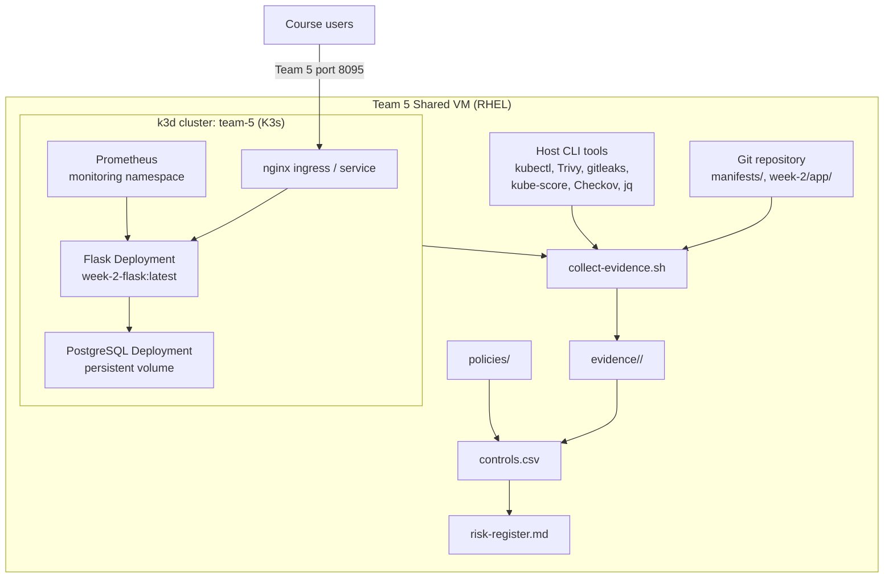

# Architecture and Evidence Flow

## Current deployment

The app and cluster are existing course components. The new governance
components are the control matrix, risk register, policies, runbook,
architecture description, QA report, and evidence collector/output.

## What we changed and why

- Added a collector that records command, output, exit status, and commit context
  into a fresh UTC-stamped evidence directory.
- Captured actual RBAC predictions/results and two default-deny NetworkPolicy
  probes using temporary, resource-limited test pods.
- Separated an explicitly supplied before-image from the live after-image so a
  scan comparison cannot silently compare an image to itself.
- Added governance documents linking control IDs to test evidence and the
  responsible Harborlight role.

The scanner outputs and cluster observations are environment-specific. A
missing scanner or before-image is recorded as not run; it is not represented as
a passing control.

